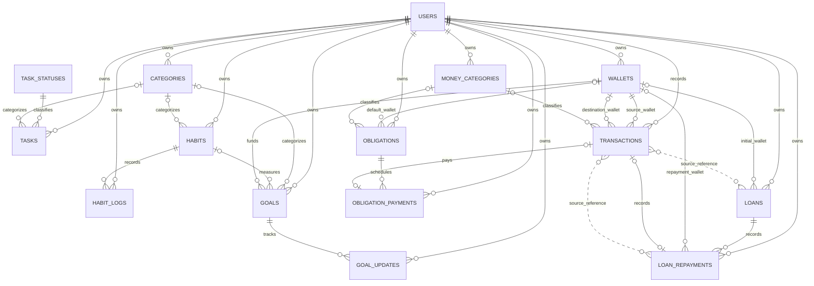

# Audit dan Rencana Arsitektur — Pusat Kehidupan Harian

## Status

Dokumen ini dimulai sebagai audit **Fase 0**. Atas arahan pemilik project, implementasi diteruskan hingga Fase 9 tanpa jeda. Modul utama sudah dibangun; bagian "Validasi akhir" mencatat status hasil eksekusi terbaru dan pekerjaan yang belum dapat dibuktikan.

## 1. Temuan audit

Audit dilakukan pada project di root ini: `C:\jadwal\list`. Yang dibaca meliputi route, controller, model, policy, form request, middleware, migrasi, seeder, factory, seluruh kelas test, layout dan komponen Blade, ikon, token CSS/Tailwind, locale, konfigurasi, `README.md`, serta `docs/DESIGN_SYSTEM.md`.

### Stack dan struktur yang ada

- PHP `^8.1`, Laravel `^10.10`, Blade, Tailwind CSS 3, Alpine.js, Vite 6, dan SQLite pada `.env.example`. `config/database.php` memakai nilai `DB_CONNECTION` dari environment dengan fallback `mysql`; jangan mengasumsikan koneksi runtime tanpa memeriksa environment.
- Bahasa aplikasi `id`, fallback `id`, zona waktu aplikasi `UTC`. Zona waktu pengguna disimpan pada `users.timezone` dan divalidasi saat profil diperbarui.
- Model yang ada: `User`, `Task`, `Category`, dan `TaskStatus`. Policy yang didaftarkan manual di `AuthServiceProvider`: `TaskPolicy` dan `CategoryPolicy`.
- Route dashboard pengguna berada di `routes/web.php` dalam middleware `auth` dan `active`, dengan `verified` bila `auth.email_verification` aktif. Panel admin punya grup `auth`, `active`, dan `admin`; profil punya grup `auth`, `active`.
- `TaskController` mengubah waktu input lokal ke UTC, lalu menampilkan konflik dalam zona waktu pemilik. `UserController` membentuk dashboard dan kalender dari tugas milik pengguna, mengubah rentang lokal ke UTC, serta memulai minggu pada Senin.
- `User` punya relasi tugas, tetapi belum ada relasi kategori/preset atau modul lain. Tidak ada direktori `Services`, `Support`, atau enum domain yang saat ini dipakai. `DatabaseSeeder` hanya menyiapkan tiga status tugas; hanya `UserFactory` tersedia.
- `app/Console/Kernel` belum menjadwalkan pekerjaan. Tidak ada antrean atau worker yang boleh diasumsikan tersedia.
- Ada **59 metode test** terdaftar dalam suite Unit dan Feature. Test yang sudah ada mencakup autentikasi, akun, profil, tugas, kalender, zona waktu, konflik jadwal, isolasi pemilik, warna kategori, dan migrasi jadwal.
- `.env.example` di root aplikasi menggunakan SQLite. Ada subfolder `list/` dengan beberapa berkas lama/duplikat, termasuk `.env.example` yang berbeda; acuan fase berikutnya adalah root aplikasi ini, bukan salinan parsial tersebut.

### Skema lama yang harus tetap utuh

- `users`: identitas, email, password, `role`, `is_active`, `timezone`, dan timestamps.
- `categories`: milik pengguna, nama, warna.
- `tasks`: milik pengguna; kategori boleh kosong; status boleh kosong; `due_date`, `starts_at`, dan `ends_at` disimpan sebagai datetime UTC.
- `task_statuses`: daftar status global; bukan data privat milik pengguna.
- Foreign key pemilik pada kategori dan tugas memakai cascade. Migrasi jadwal yang ada mengubah data `due_date` lama dari interpretasi waktu Jakarta ke UTC. Riwayat migrasi lama juga pernah menghapus tabel fitur tugas yang tidak dipakai; jangan membalik atau mengubah migrasi tersebut.
- Route yang sudah ada dan harus dipertahankan: beranda, kalender, CRUD tugas dan tandai selesai, profil, autentikasi, serta manajemen akun admin. Teks, input `datetime-local`, warna inline kategori, dan ID `mobileNavigationMenu` dikunci oleh test yang ada.

### Pola implementasi yang bisa dipakai ulang

- Tampilan: `layouts.user`, `layouts.admin`, `layouts.guest`, dan `layouts.error`.
- Komponen: `x-icon`, `x-field`, input/label/error, tombol primer/sekunder/bahaya, `x-alert`, `x-toast`, `x-modal`, `x-confirm-action`, `x-empty-state`, `x-page-header`, `x-status-badge`, `x-task-actions`, dan `x-skeleton`. `/styleguide` hanya tersedia di environment `local`.
- Ikon yang sekarang terdaftar berjumlah 27; sprite memakai grid 24, outline `currentColor`, garis 1.8, dan ujung membulat. Direktori `public/ilustrasi/` tidak ada. Jangan membuat ilustrasi baru.
- Palet, radius, shadow, fokus keyboard, dan aturan gerak tereduksi sudah ditetapkan di `resources/css/app.css` dan `tailwind.config.js`. Figtree dimuat lokal. Jangan mengganti token.
- Locale Indonesia dan berkas autentikasi, validasi, password, pagination sudah tersedia di `lang/id`.
- Belum ada komponen uang/progres/pilih hari/lembar bawah, enum fitur, preset, atau service domain baru.

### Ketidaksesuaian dan utang teknis terverifikasi

1. `Task` dan `Category` saat ini memasukkan `user_id` di `$fillable`. `TaskController` memakai relasi pemilik untuk membuat tugas, tetapi resolver kategori serta sejumlah test membuat kategori dengan `Category::create()`. Fitur baru tetap harus mengikuti aturan brief: jangan menerima `user_id` dari request atau mass assignment; bila aturan itu diterapkan ke model lama, jalur pembuatan lama dan fixture test perlu disesuaikan tanpa mengubah kontrak route.
2. `TaskController` membuat kategori baru tanpa mencari kategori yang sama terlebih dahulu.
3. Filter tugas terlambat memeriksa `due_date < now()` saja; ia tidak mengecualikan status selesai dan tidak memakai `ends_at`. Dashboard memiliki kondisi terlambat berbeda.
4. Status selesai dicari melalui nama `"Selesai"` pada lebih dari satu tempat.
5. `ProfileController::destroy` belum mencegah admin aktif terakhir menghapus akunnya sendiri. Guard yang ada hanya berada pada aksi penghapusan di panel admin.
6. README memakai `migrate --seed` untuk instalasi lokal, tetapi checklist production belum mencantumkan `db:seed`.
7. `docs/DESIGN_SYSTEM.md` masih mendeskripsikan ikon dengan satu aksen warna, sedangkan sprite dan `DAFTAR_IKON_CUSTOM.md` saat ini memakai outline tanpa blok warna. Perbarui dokumentasi desain agar sesuai ikon aktual pada fase penutup.
8. Laravel/PHP yang dipakai jangan dinaikkan major dalam pekerjaan ini. Status dukungan keamanan versi akan diverifikasi terpisah pada fase penutup; rekomendasi upgrade tetap pekerjaan terpisah.

## 2. Diagram relasi

Garis putus-putus menandakan referensi polimorfik `transactions.source_type/source_id`, bukan foreign key database. Semua tabel data personal baru memiliki `user_id` dengan cascade saat akun dihapus. Relasi FK lain dan perilaku penghapusan selain aturan yang sudah tegas di brief ditentukan saat migrasi modulnya dibuat.

Entitas baru dan cakupan datanya:

| Modul | Tabel |
|---|---|
| Kebiasaan | `habits`, `habit_logs` |
| Target | `goals`, `goal_updates` |
| Dompet dan catatan uang | `wallets`, `money_categories`, `transactions` |
| Tagihan dan cicilan | `obligations`, `obligation_payments` |
| Utang dan piutang | `loans`, `loan_repayments` |
| Pengaturan | kolom tambahan bernilai default pada `users` |

`AgendaService` hanya membaca dan menyatukan data menjadi DTO; tidak menambah tabel agenda.

## 3. Keputusan desain dan asumsi

1. **Kompatibilitas:** semua migrasi fitur baru bersifat additive. Tabel/kolom lama, route dan nama route yang ada tetap dipertahankan. Kolom pengaturan pengguna baru memiliki default yang aman.
2. **Pemilik dan otorisasi:** query modul selalu berangkat dari relasi pengguna yang login, referensi `*_id` divalidasi terhadap pemilik, route binding dibatasi pemilik, dan setiap model memiliki policy. Policy modul pengguna menolak admin secara eksplisit; middleware `active`/`verified` saja bukan pengganti otorisasi data.
3. **Mass assignment:** `user_id` tidak berasal dari input dan tidak masuk `$fillable` model baru. Pembuatan dilakukan melalui relasi pengguna; untuk child record, controller juga memastikan parent dimiliki pengguna yang sama. Memperbaiki `$fillable` pada model lama memerlukan refactor jalur pembuatan dan test lama yang saat ini mengandalkan `Category::create()`.
4. **Tanggal:** `UserClock` menjadi satu sumber tanggal lokal pengguna (`CarbonImmutable`/nilai tanggal yang konsisten), berdasarkan zona waktu akun. Domain tidak membaca `now()` langsung; `Carbon::setTestNow` menjadi dasar pengujian. `DATE` menyimpan tanggal bisnis lokal, sedangkan timestamps dan arsip tetap UTC. Konversi jadwal `Task` tetap menggunakan pola yang sudah ada.
5. **Uang:** semua nominal Rupiah berupa integer; tidak menggunakan float atau pecahan. Parser tunggal menerima digit polos atau pemisah ribuan titik yang valid, menolak format ambigu/tidak valid dan nilai di atas batas wajar brief. Saldo dompet dan ringkasan dihitung dari transaksi teragregasi, bukan kolom saldo hasil cache.
6. **Konsistensi keuangan:** pemasukan, pengeluaran, dan transfer memengaruhi saldo sesuai arah; transfer tidak menjadi pemasukan/pengeluaran pada ringkasan. Sumber pinjaman/pembayaran pinjaman memengaruhi saldo namun dikecualikan dari ringkasan pemasukan/pengeluaran. Pembayaran tagihan/cicilan tetap dihitung sebagai pengeluaran. Operasi pembayaran dan pasangan transaksinya selalu dalam satu `DB::transaction`.
7. **Idempotensi:** aturan unik log kebiasaan per hari dan pembayaran kewajiban per periode dipertahankan. Kategori uang bawaan dibuat malas dan idempoten per pengguna; constraint unik per pemilik/jenis/nama perlu dipakai untuk menutup race condition.
8. **Kebiasaan:** minggu dimulai Senin. Hari `skipped` tidak menambah atau memutus beruntun; hari terjadwal yang kosong memutus, kecuali hari ini yang masih menunggu. Minggu berjalan yang belum mencapai target tidak memutus beruntun mingguan. Kebiasaan yang sudah diarsipkan tidak masuk daftar hari ini.
9. **Target:** progres dihitung oleh service terpisah per jenis; persen dibatasi 0–100 dan status tercapai hanya berubah setelah tindakan pengguna. Validasi menjaga `target_value` lebih besar daripada `start_value` agar pembagi progres positif. Untuk target kebiasaan yang tidak memiliki tanggal mulai sendiri, asumsi awal adalah menghitung sejak tanggal lokal pembuatan target atau tanggal mulai kebiasaan, mana yang lebih akhir; detail ini diuji dan dapat ditinjau sebelum Fase 6.
10. **Agenda:** item tugas/kebiasaan/tagihan/cicilan/jatuh tempo utang/target dipetakan ke tipe, judul, waktu opsional, status, URL, dan aksi cepat. Service tetap read-only; aksi cepat mengarah ke endpoint/form modul masing-masing.
11. **Progressive enhancement:** penyimpanan tetap berupa form HTTP/POST standar. Alpine boleh memformat input atau membuka lembar, tetapi tindakan inti tidak bergantung pada JavaScript. Navigasi dan pilihan tambah hanya ditampilkan sebagai aksi aktif bila destination-nya sungguh berfungsi; ini mencegah tautan/tombol palsu saat fase modul bertahap.
12. **Email ringkasan:** opt-in mati secara default. Karena tidak ada worker yang diasumsikan aktif, perintah terjadwal mengirim secara sinkron; `digest_last_sent_on` diperbarui hanya setelah kirim berhasil, menggunakan tanggal dan jam lokal pengguna. Jangan mencatat nominal atau catatan keuangan ke log.
13. **Penghapusan riwayat uang:** brief belum menetapkan perilaku penghapusan dompet/transaksi/pinjaman/kewajiban yang sudah memiliki riwayat. Asumsi aman untuk implementasi adalah tidak menghapus transaksi yang sudah memengaruhi saldo secara diam-diam; tentukan aturan arsip/pembatalan dan FK sebelum mengerjakan modul terkait.
14. **Navigasi bertahap:** item akhir yang diminta adalah Beranda, Tugas, Kebiasaan, Keuangan, dan Lainnya; Kalender, Target, Profil, Keluar berada di Lainnya. Tombol tambah membuka enam jenis pilihan. Karena route beberapa modul belum ada, tautan tersebut baru diaktifkan bersama modul yang benar-benar bisa digunakan; ID `mobileNavigationMenu` tetap.
15. **UI:** semua layar baru memakai layout, komponen, ikon outline, dan token yang sudah ada. Tabel menjadi kartu di ponsel, target sentuh minimal 44 px, status tetap terbaca sebagai teks, dan pemeriksaan layar 360 px dilakukan saat modul UI dibangun. Tidak menambah dependency, library grafik, framework JS, atau ilustrasi.

## 4. Ikon dan komponen yang direncanakan

Ikon baru ditambahkan ke sprite 24×24 yang ada dan ke whitelist `x-icon`, dengan stroke, ujung, dan gaya outline yang sama. Ikon yang dibutuhkan:

- `dompet`, `kebiasaan`, `target`
- `uang-masuk`, `uang-keluar`, `pindah-dana`
- `tagihan`, `cicilan`, `utang`, `piutang`
- `lonceng`, `arsip`, `salin`, `lainnya`

Komponen Blade reusable baru:

- kapsul pemilih hari,
- input Rupiah dengan tampilan hasil format,
- progress bar/circle,
- lencana tanggal relatif,
- bottom sheet/lembar bawah.

Komponen dan ikon baru dimasukkan ke `/styleguide` saat implementasi, dengan dokumentasi sistem desain yang konsisten dengan sprite aktual. Tidak ada ilustrasi baru karena `public/ilustrasi/` tidak tersedia.

## 5. Rencana fase

Urutan dan batas fase mengikuti brief. Atas arahan pemilik, fase-fase dikerjakan berkesinambungan sampai penutupan, bukan dihentikan untuk menunggu persetujuan di antara fase.

| Fase | Cakupan |
|---|---|
| 0 — Audit dan rencana | Dokumen ini; tanpa kode fitur. Selesai. |
| 1 — Fondasi | `UserClock`, helper/parser Rupiah, lazy-loading guard, komponen/ikon baru, navigasi/add sheet progresif, locale, kerangka `AgendaService`, preset, dan test dasar. Jaga seluruh test lama. |
| 2 — Kebiasaan | Skema, enum, relasi, policy/request/controller/view/factory, check-in yang dapat dibatalkan, streak/statistik, preset, test unit dan feature. |
| 3 — Keuangan A | Dompet, kategori uang, transaksi pemasukan/pengeluaran/transfer, ringkasan bulanan, privasi nominal, validasi ownership, transaksi atomik, dan test. |
| 4 — Keuangan B | Tagihan/cicilan, perhitungan tanggal jatuh tempo, pembayaran dan pembatalan atomik, status periode, dan test. |
| 5 — Keuangan C | Utang/piutang, saldo tersisa, pembayaran sebagian, transaksi opsional, pesan pengingat siap salin, dan test. |
| 6 — Target | Target angka/tabungan/kebiasaan, service progres, estimasi, catatan perubahan, dan test. |
| 7 — Beranda dan Kalender terpadu | `AgendaService` lengkap, urutan Beranda sesuai brief, item perhatian, progres kebiasaan, ringkasan uang/onboarding, Kalender terpadu dan legenda. Pertahankan teks yang dikunci test. |
| 8 — Pengingat dan pengaturan | Opt-in ringkasan harian, command, jadwal hourly, view email Indonesia, pengaturan Profil, konfigurasi dan dokumentasi cron. |
| 9 — Laporan dan penutup | Laporan bulanan, test keamanan/performa/aksesibilitas, audit 360 px, dokumentasi/styleguide/README, verifikasi status dukungan versi, dan hanya utang teknis kecil yang dicatat brief. |

Untuk setiap fase, cakupan test mencakup isolasi antar pengguna, IDOR pada ID parent, 403 untuk admin, penghapusan akun/cascade bila relevan, dan regresi test lama. Unit test service domain memakai waktu beku. Tidak ada perubahan pada test lama kecuali diperlukan untuk migrasi pola pemilik yang aman, dengan alasan dicatat.

## 6. Risiko yang perlu dijaga

- Kesalahan pemetaan waktu lokal dapat menggeser hari di WIB/WITA/WIT. Pisahkan tanggal bisnis `DATE` dari waktu UTC dan uji batas tengah malam.
- `user_id` yang dapat di-mass-assign pada model lama perlu ditangani tanpa mematahkan jalur pembuatan dan test yang ada.
- `transactions` menjadi sumber saldo; setiap aksi multi-tabel wajib atomic, transfer tidak boleh dihitung ganda, dan kebijakan penghapusan tidak boleh merusak riwayat.
- SQLite adalah basis kompatibilitas minimal; migrasi, constraint, dan agregasi perlu diuji juga terhadap perilaku SQLite. Nilai fallback koneksi database di config berbeda dari `.env.example`.
- Jumlah item agenda, kebiasaan, dompet, dan transaksi dapat membuat N+1 atau query berulang. Gunakan eager loading/agregasi serta test jumlah query yang memiliki ambang tetap.
- Fase bertahap berisiko menghasilkan tautan ke modul yang belum dibuat. Jaga progressive enhancement dan jangan menampilkan aksi palsu.
- Ringkasan email berjalan tanpa queue worker; kirim secara terkendali dan idempoten dalam jadwal hourly, dan jangan mengekspos data keuangan sensitif di log.
- Beberapa perilaku hapus/arsip dan referensi ke transaksi belum dispesifikasikan. Putuskan secara konservatif sebelum fase terkait, tanpa menambah fitur di luar brief.

## 7. Validasi akhir dan keputusan

- Implementasi mencakup migrasi, model, factory, policy kepemilikan, form request, controller, view, agenda terpadu, email digest opt-in, ringkasan laporan, dan test untuk fitur baru.
- Hasil validasi terakhir: `php artisan test` **81 lulus, 314 assertion**; `npm run build` berhasil; `artisan view:cache` dan route report berhasil.
- Pint lulus pada 69 file PHP domain/terkait. `pint --test` seluruh workspace masih melaporkan 37 isu format, semuanya berada pada file lama di luar perubahan fitur ini, termasuk salinan proyek lama dalam `list/`.
- Tidak ada dependensi baru. Data demo hanya di-seed pada environment `local`.
- Penghapusan pembayaran tagihan/cicilan membatalkan transaksi terkait secara atomik. Penghapusan akun menghapus data pemilik melalui foreign key cascade. Transaksi pinjaman dibedakan melalui `source_type` dan dikecualikan dari ringkasan pemasukan/pengeluaran.
- Saldo awal dompet boleh negatif, sementara nominal transaksi/pembayaran tetap dibatasi pada bilangan Rupiah positif.
- Halaman Kebiasaan, Keuangan, Tagihan/Cicilan, Utang/Piutang, Target, dan Laporan diuji di browser pada lebar 360, 390, 768, dan 1280 px; semua merespons HTTP 200 tanpa overflow horizontal. Aksesibilitas pola label, target sentuh, teks status, dan batang laporan ditinjau; uji pembaca layar lintas browser belum dilakukan.
